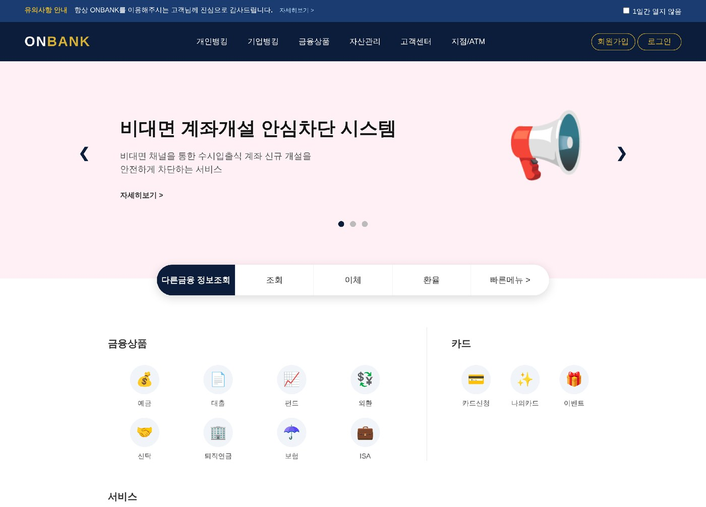
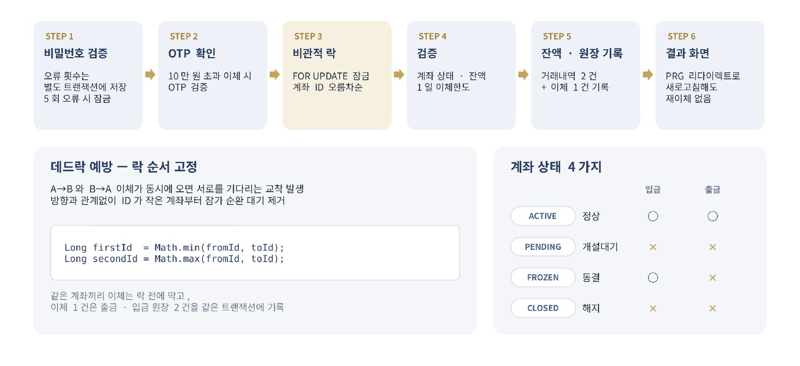
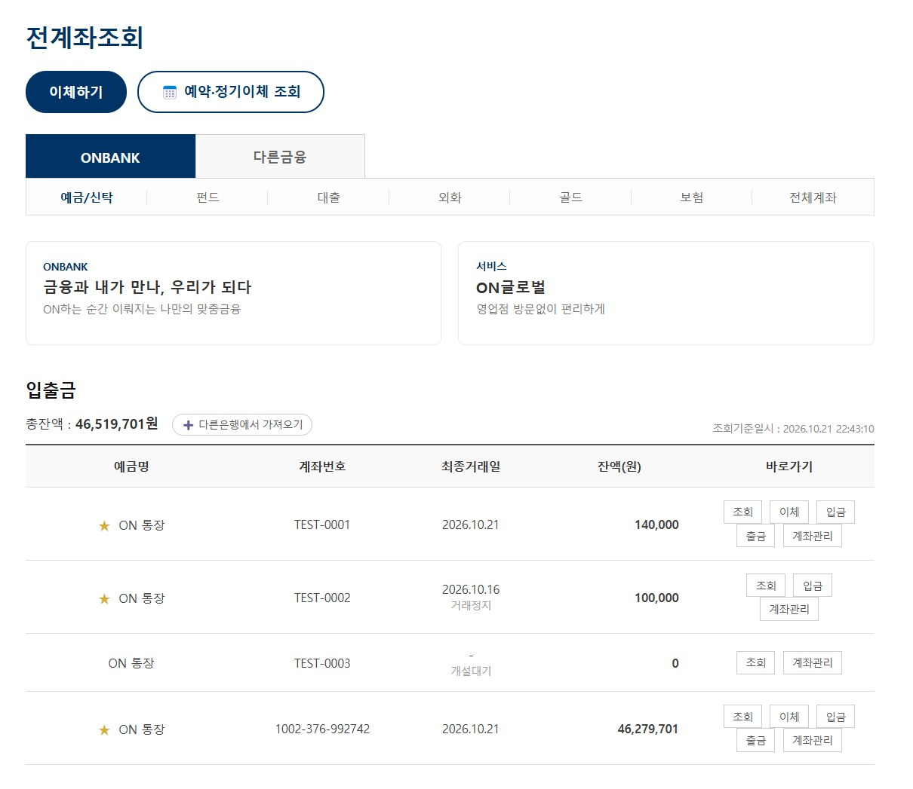
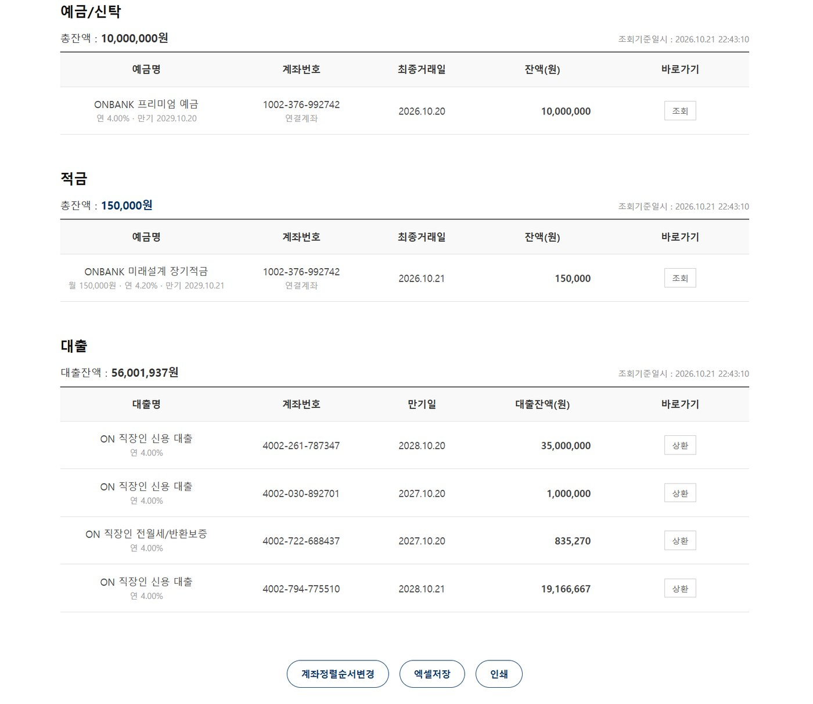
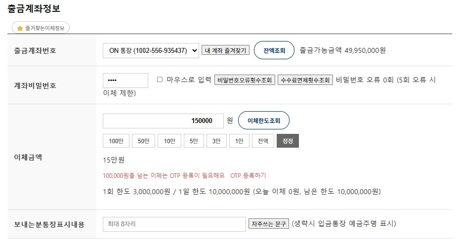
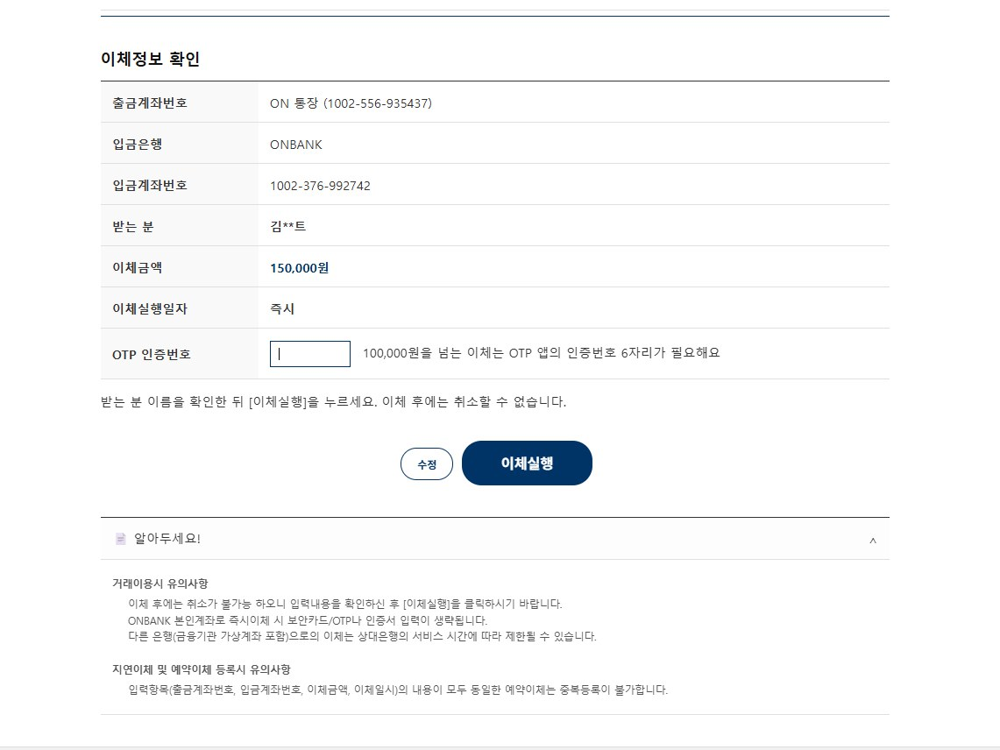
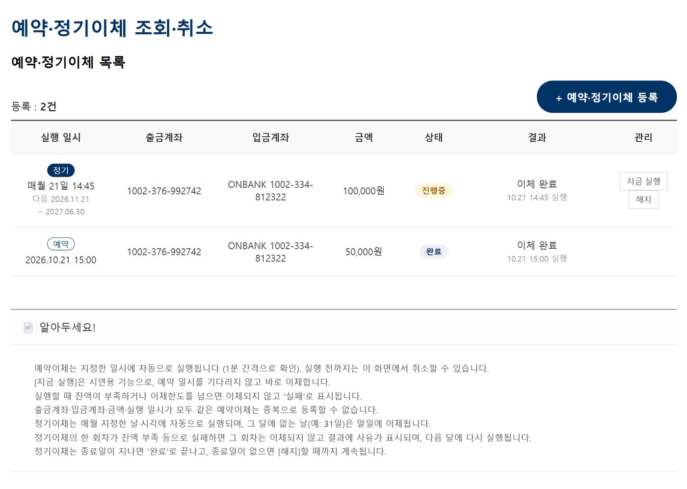
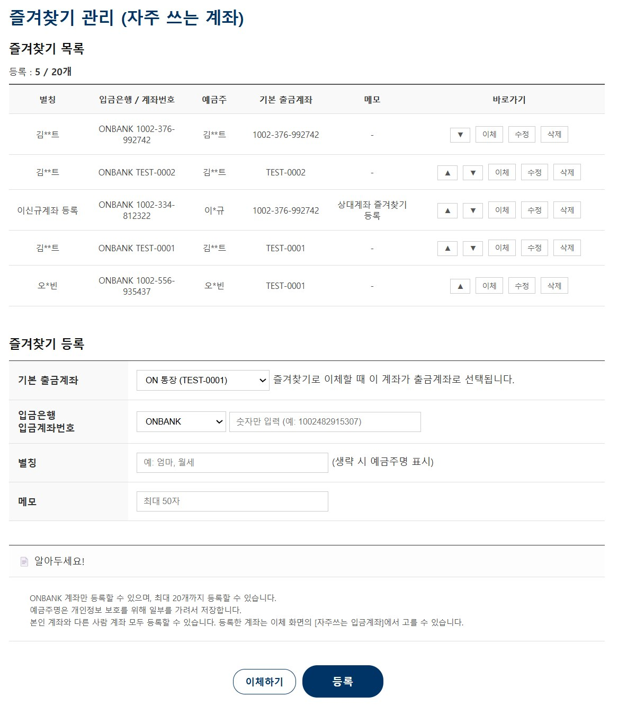
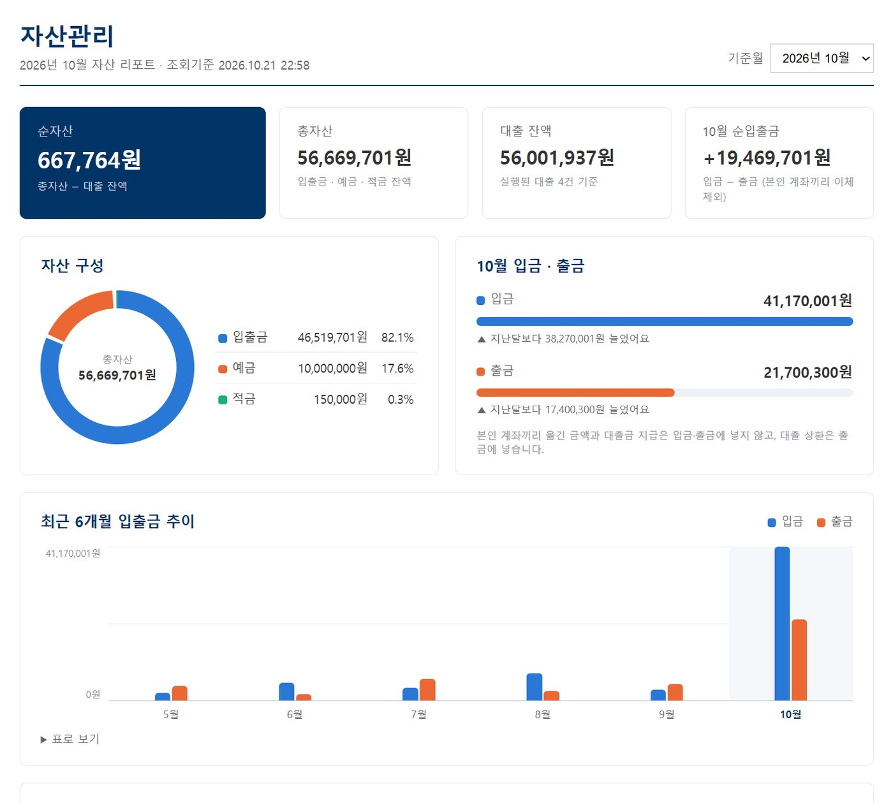
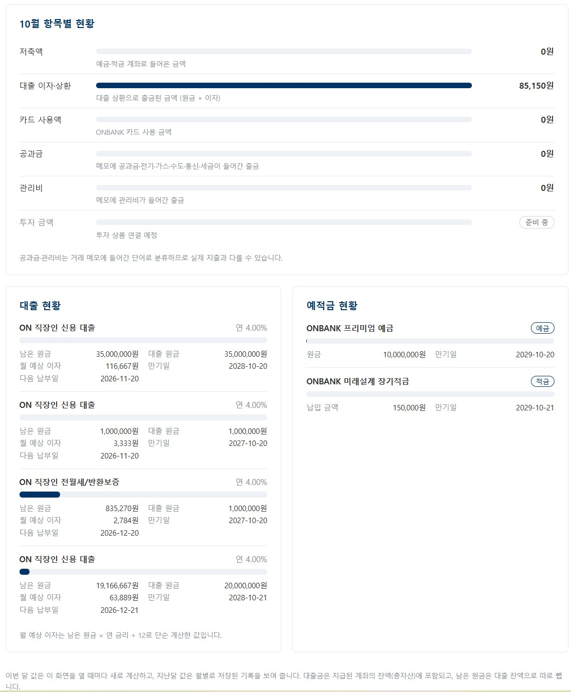

<div align="center">

# 🏦 ONBANK (온뱅크)

**Spring Boot 기반 모의 인터넷뱅킹 서비스**



</div>

<br>

## 📌 프로젝트 소개

실제 인터넷뱅킹을 참고해 만든 **모의(가상) 인터넷뱅킹 서비스**입니다.<br>
고객은 계좌 개설·이체·예적금·대출을, 직원과 관리자는 회원·계좌 관리와 이상거래 모니터링을 할 수 있습니다.<br>
Spring Boot, JPA, Security로 계좌·이체·상품·관리업무를 4개 파트로 나누어 구현했습니다.

| 항목 | 내용 |
|---|---|
| 기간 | 2026.10.06 ~ 2026.10.23 (3주) |
| 인원 | 4명 |
| 과정 | 쌍용교육센터 Java Full-Stack 개발자 양성 과정 파이널 팀 프로젝트 |
| 담당 | **팀원 2 — 계좌 / 이체 / 자산관리 파트** |

<br>

## 🛠 개발 환경

| 구분 | 기술 |
|---|---|
| Backend | Java 21, Spring Boot 4.1.1, Spring MVC, Spring Security, Spring Data JPA |
| Frontend | Thymeleaf (서버 사이드 렌더링), HTML / CSS / JavaScript |
| Database | MySQL (테이블은 SQL 파일로 생성, JPA는 `ddl-auto=validate`) |
| Test | JUnit 5, Mockito, Spring MVC Test |
| Build / 협업 | Gradle, Git / GitHub (브랜치 → PR → main) |
| 배포 | GitHub Actions |

<br>

## 👥 팀 구성

| 파트 | 담당 영역 |
|---|---|
| 팀원 1 | 회원가입·로그인(고객/직원/관리자 분리), Spring Security, 마이페이지·보안설정, 가상 OTP, 지점/ATM 찾기 |
| **팀원 2 (본인)** | **계좌 개설, 입출금, 즉시·예약·정기이체, 즐겨찾기, 자산관리 리포트** |
| 팀원 3 | 예적금 상품 가입·해지, 대출 신청·상환 |
| 팀원 4 | 직원·관리자 화면(백오피스), 이상거래(FDS) 모니터링, 고객센터, 공통 레이아웃, 배포 |

<br>

## 🏗 이체 처리 흐름



비밀번호 검증 → OTP 확인 → 비관적 락 → 검증 → 잔액·원장 기록 → 결과 화면(PRG) 순서로 처리합니다.

<br>

## 🙋‍♀️ 담당 역할 (오수빈)

### 1. 전계좌조회 · 계좌 관리

| 전계좌조회 | 예적금 · 대출 연동 |
|---|---|
|  |  |

- 정상·개설대기·동결·해지 4가지 상태의 입출금 가능 여부를 enum으로 정의해, 화면 버튼과 서버 검증에 같은 규칙 적용
- 입출금 계좌(ON 통장) 개설: 비밀번호 4자리 + 약관 동의 → `1002-XXX-XXXXXX` 형식 계좌번호 발급 (중복 시 최대 5회 재생성)
- 계좌 비밀번호는 BCrypt로 암호화해 저장
- 관리자 화면에서 호출하는 계좌 상태 변경 메서드 제공 (승인·반려·동결·해제·해지·비밀번호 잠금 해제)
- 다른 파트의 예적금·대출 테이블은 조회만 해서 한 화면에 모으고, 조회가 실패해도 화면은 열리도록 영역별 안내 처리

### 2. 입출금 · 즉시이체

| 이체 입력 | 이체 정보 확인 |
|---|---|
|  |  |

- 한글 금액, 잔액·1회 한도 초과 여부를 입력 즉시 안내하고 최종 판단은 서버에서 다시 검증
- 1회 / 1일 이체 한도, 날짜가 바뀌면 당일 누적 이체액 초기화
- 10만 원 이하는 계좌 비밀번호, 10만 원 초과 타인 이체는 OTP까지 확인 (팀원 1의 OTP 모듈 연동)
- 비밀번호 오류 횟수 누적 → 5회에 도달하면 출금·이체 잠금
- 받는 분 이름 가림 처리(예: `김*수`), 확인 단계 후 이체
- POST 처리 후 결과 화면으로 리다이렉트(PRG)해 새로고침해도 이체가 다시 실행되지 않도록 구현

### 3. 예약 · 정기이체 / 즐겨찾기

| 예약 · 정기이체 조회 | 즐겨찾기 관리 |
|---|---|
|  |  |

- 예약이체: 날짜·시각을 지정해 등록 → `@Scheduled` 스케줄러가 매분 실행 대상을 찾아 이체
- 정기이체: 매월 N일 자동 이체, 종료일 지정, 31일 선택 시 말일에 실행
- 등록 시점에 비밀번호·OTP를 검증하고, 실행 시점에는 잔액·한도·계좌 상태만 다시 확인
- 조회·취소(해지) 화면, 시연용 [지금 실행] 버튼
- 자주 쓰는 계좌 등록·수정·삭제·순서 변경, 내 계좌인지 여부로 출금용·입금용을 나눠 이체 화면에 표시

### 4. 자산관리 리포트

| 자산 요약 · 추이 | 항목별 현황 |
|---|---|
|  |  |

- 입출금 잔액과 예적금 원금을 더한 총자산에서 대출 잔액을 빼 순자산 계산
- 월별 입금·출금, 저축액, 대출 상환액 집계 (같은 거래번호의 상대 기록도 내 계좌면 제외해 지출이 부풀려지지 않게 처리)
- 외부 차트 라이브러리 없이 SVG(도넛)·CSS(막대)로 그래프 구현, "표로 보기" 제공

### 5. 공통 디자인
- 메인 페이지, 로고 · 파비콘 제작 및 적용

<br>

## ▶️ 실행 방법

1. MySQL에 DB를 만들고 `project/onbank/src/main/resources/db/`의 DDL을 **01 → 03 → 02** 순서로 실행합니다. (02가 03의 테이블을 참조합니다)
2. `application-local.properties.example`을 복사해 `application-local.properties`를 만들고 DB 접속 정보를 입력합니다.
3. 실행합니다.
   ```bash
   cd project/onbank
   ./gradlew bootRun
   ```
4. 브라우저에서 http://localhost 로 접속합니다. (포트 80)

<br>

## 📁 프로젝트 구조 (계좌 파트)

```
project/onbank/src/main/java/org/doit/onbank/account/
├── controller/   계좌·이체·즐겨찾기·예약이체·자산 리포트 화면
├── service/      입출금·이체·계좌 개설·예약이체 실행·자산 집계
├── entity/       Account, ScheduledTransfer 등 (상태 변경 규칙을 엔티티 메서드로)
├── repository/   Spring Data JPA, 집계 조회
├── scheduler/    예약·정기이체 스케줄러 (매분 실행)
└── dto/          화면 입력·출력 객체
```
